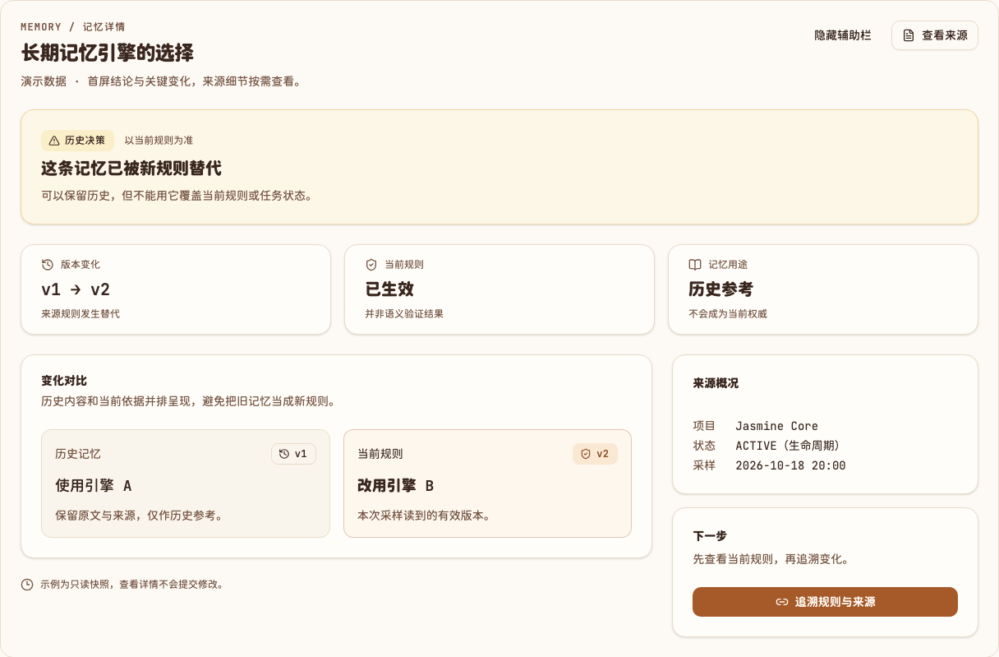
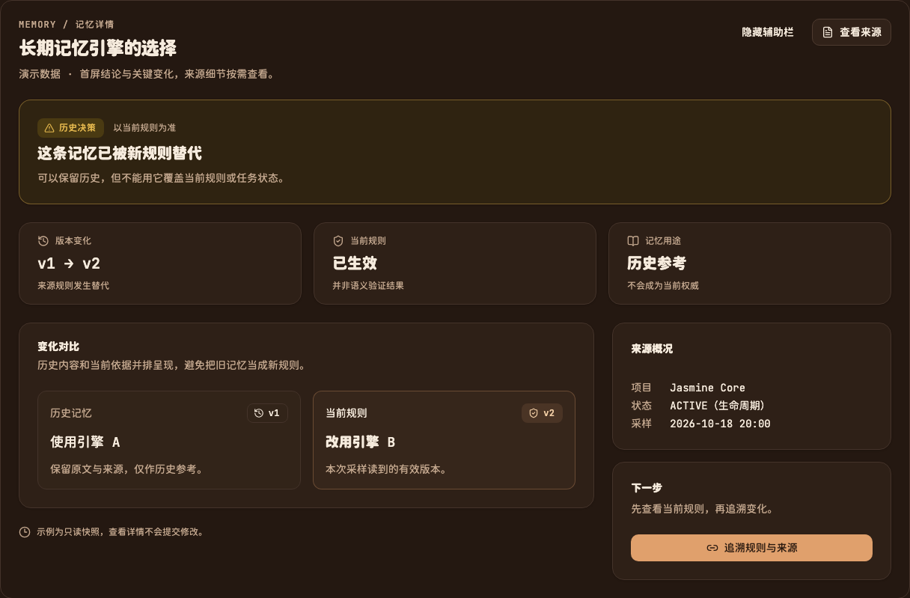
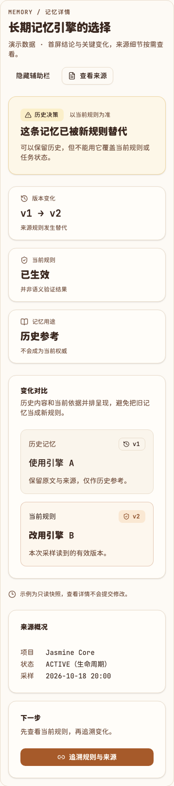
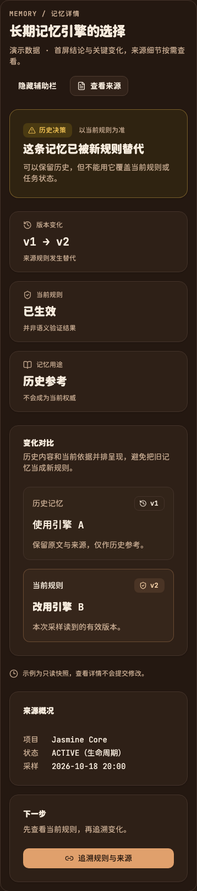

# DetailLayout 验证记录

候选源码：`8feb0609290670f4eaeac666149a8c5cc04fb72a`。本记录与截图只补充验证资料，不改组件源码。
范围：真实 Chrome 的静态文档示例，所有业务数据明确标记为演示，不连接 Core、Memory 或日常服务。

## 结果

- `pnpm typecheck`、`pnpm registry:build`、`pnpm build` 通过；使用仓库指定的 pnpm 10.28.0。
- Chrome 155.0.8059.80，17 项浏览器检查通过。
- 1440px 与 390px 视口，亮/暗主题：页面及组件均无横向溢出；主区与辅助栏按宽屏 2:1、窄屏顺序排列。
- 采样文字/状态标签的对比度均 ≥ 4.5:1，最低 5.37:1；不更改既有主题 token。
- 隐藏辅助栏后主区占满；打开来源 Sheet、Escape 关闭、焦点回到触发按钮均通过。
- registry 包含与源码一致、仅替换导入别名的可安装组件内容。

原始回执：[detail-layout-browser.json](detail-layout-browser.json)。

## 复现

运行 `pnpm install --frozen-lockfile`、`pnpm typecheck`、`pnpm registry:build`、`pnpm build`，
然后 `pnpm dev`，打开文档站的 `?preview=detail-layout`。
在 1440px/390px 视口分别检查亮/暗主题（独立预览继承系统主题，可在浏览器模拟偏好），
核对摘要、3 个指标、主区与辅助栏顺序；点击隐藏/显示辅助栏、查看来源并按 Escape。

## 实际浏览器截图（演示数据）

手机亮/暗主题

