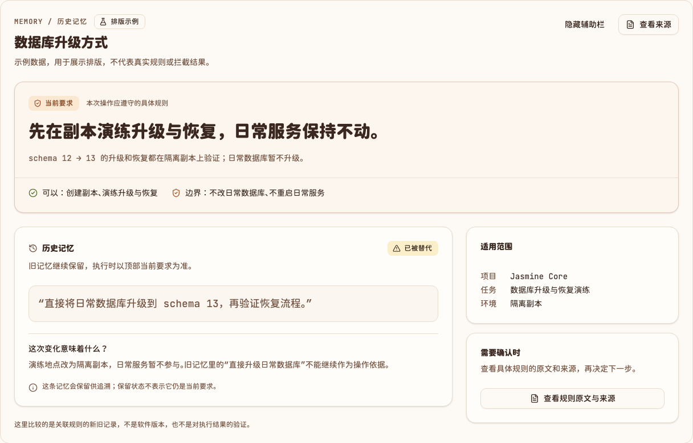
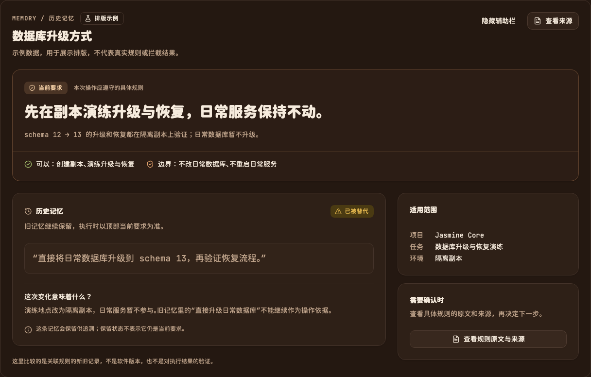

# 具体规则优先的实例页

候选 `e63f4dbf2523af8b54ff6d78a8b5131ff3fadf1e`。此示例调整信息层级，不改变 DetailLayout 的 API 或任何业务接口。
顶部直接显示“先在副本演练升级与恢复，日常服务保持不动”，并说明允许操作和边界。
不单列版本变化/已生效/历史参考卡片；旧记忆作为次要内容，版本与 ACTIVE 状态放进来源 Sheet。
所有记录均是明确标注的模拟数据，尤其旧记忆的“直接升级日常数据库”不是用户真实历史指令。

验证：typecheck、build 通过，真实 Chrome 20 项检查通过，包含 1440/390px 亮暗主题、无横向溢出、
文字对比度 ≥ 4.5:1、主辅栏与无辅助栏、首屏具体规则、版本详情默认隐藏，以及两个来源按钮的 Escape 焦点恢复。
此前 PR 的焦点修复提交已合入此候选，不覆盖历史验证记录。

[浏览器回执](rule-example-browser.json)。本次仅为静态排版示例，不连接或修改日常 Core/Memory 服务。

复现：`pnpm dev` 后打开 `?preview=detail-layout`。点击“查看来源”可看到规则原文与版本解释。

